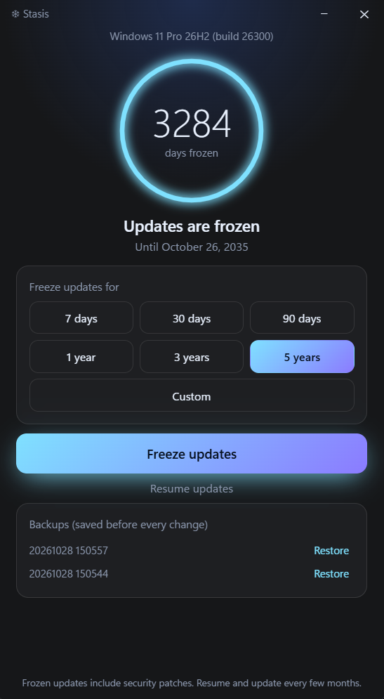

<div align="center">



[](https://github.com/Shariqtechie/Stasis/releases/latest)
[](https://github.com/Shariqtechie/Stasis/stargazers)
[](https://github.com/Shariqtechie/Stasis/releases)
[](LICENSE)

### Windows restarted your PC again?
**Windows 11 pauses updates for 5 weeks. Stasis pauses them for years, without breaking anything.**

[**⬇ Download Stasis.exe**](https://github.com/Shariqtechie/Stasis/releases/latest/download/Stasis.exe) &nbsp;·&nbsp; [Website](https://shariqtechie.github.io/Stasis/) &nbsp;·&nbsp; [Report a bug](../../issues/new/choose)

<br>



</div>

> [!TIP]
> **If Stasis saves you from a forced restart, please [⭐ star the repo](https://github.com/Shariqtechie/Stasis).** It takes two seconds and helps other people find a safer way to pause Windows Update.

Stasis was formerly *Windows Update Pause Manager*.

## The problem

Windows Settings caps your pause at 5 weeks, then makes you update before you can pause again. The popular fix is a "disable Windows Update" tool, but many of those stop services and block Microsoft servers. People regularly report that this breaks the Microsoft Store and app installs, and some say they ended up reinstalling Windows.

Stasis takes a different route. It sets the same pause dates Windows Settings uses, just further out.

## Stasis vs the alternatives

| | Windows Settings | "Disable updates" tools | **Stasis** |
|---|---|---|---|
| Longest pause | 5 weeks | Forever, no end date | **Up to 10 years, you pick the date** |
| Stops services or blocks Microsoft servers | No | Often | **Never** |
| Reports of a broken Microsoft Store | No | Common | **No** |
| Needs a reinstall to fix problems | No | Sometimes reported | **No** |
| Undo | One click | Often manual or risky | **One click, or Resume in Settings** |
| Settings backed up first | n/a | Rarely | **Always** |

## Features

- **One click:** 7 days to 5 years, or any custom date up to 10 years out.
- **Live countdown ring** showing how long your PC stays frozen.
- **Extend anytime** without starting over.
- **Honest about the source:** it tells you whether a pause came from Stasis or Windows Settings.
- **Automatic backups** before every change, with one-click restore.
- **Private:** no network access, no telemetry, no account.
- **Tiny and native:** Rust and Tauri, about 5 MB, a Windows 11 Mica window.

## How it works


## Quick start

1. Download **[Stasis.exe](https://github.com/Shariqtechie/Stasis/releases/latest/download/Stasis.exe)** from the latest release.
2. Run it and allow the admin prompt. The pause values live in `HKEY_LOCAL_MACHINE`.
3. Choose a length and click **Freeze updates**.
4. To go back to normal, click **Resume updates** in Stasis, or open **Settings → Windows Update** and click **Resume updates**. Stasis doesn't need to be open.

Windows SmartScreen may warn about a new, unsigned app. Compare the SHA256 file in the release with your download, or build from source.

## Compatibility

| Edition | 23H2 | 24H2 | 25H2 |
|---|---|---|---|
| Windows 11 Home | 🟡 Testing | 🟡 Testing | 🟡 Testing |
| Windows 11 Pro | 🟡 Testing | 🟡 Testing | 🟡 Testing |
| Windows 11 Enterprise | 🟡 Testing | 🟡 Testing | 🟡 Testing |

Windows 10 reached end of support in October 2025, so it is low priority. Tested an edition? [Tell us](../../issues/new/choose).

<details>
<summary><b>Is it safe to freeze updates for years?</b></summary>

Freezing also pauses security patches. Pick a length you are comfortable with, and resume to catch up every few months. Stasis is a convenience tool, not a security product.
</details>

<details>
<summary><b>Build from source</b></summary>

Needs Node 20+ and the [Rust toolchain](https://rustup.rs) on Windows.

```bash
npm install
npm run build        # outputs src-tauri/target/release/stasis.exe
```

To publish a release, run **Actions → Build & Release → Run workflow** and type a version such as `1.2.0`.
</details>

## Roadmap

- [x] Frameless Mica window
- [x] Extend freeze and About panel
- [ ] Resume reminder before your freeze ends
- [ ] Verified results for every Windows 11 edition
- [ ] winget and Scoop packages
- [ ] Signed releases

## Help Stasis grow

- ⭐ **[Star the repo](https://github.com/Shariqtechie/Stasis)** so others can find it
- 🔁 **Share it** with a friend who is tired of forced restarts
- 🐛 **[Report a bug](../../issues/new/choose)** or test an edition in a VM
- 🤝 See [CONTRIBUTING.md](CONTRIBUTING.md) to help build it

## Star history

<a href="https://star-history.com/#Shariqtechie/Stasis&Date">
  <picture>
    <source media="(prefers-color-scheme: dark)" srcset="https://api.star-history.com/svg?repos=Shariqtechie/Stasis&type=Date&theme=dark">
    <source media="(prefers-color-scheme: light)" srcset="https://api.star-history.com/svg?repos=Shariqtechie/Stasis&type=Date">
    
  </picture>
</a>

## License

MIT. Not affiliated with or endorsed by Microsoft.
